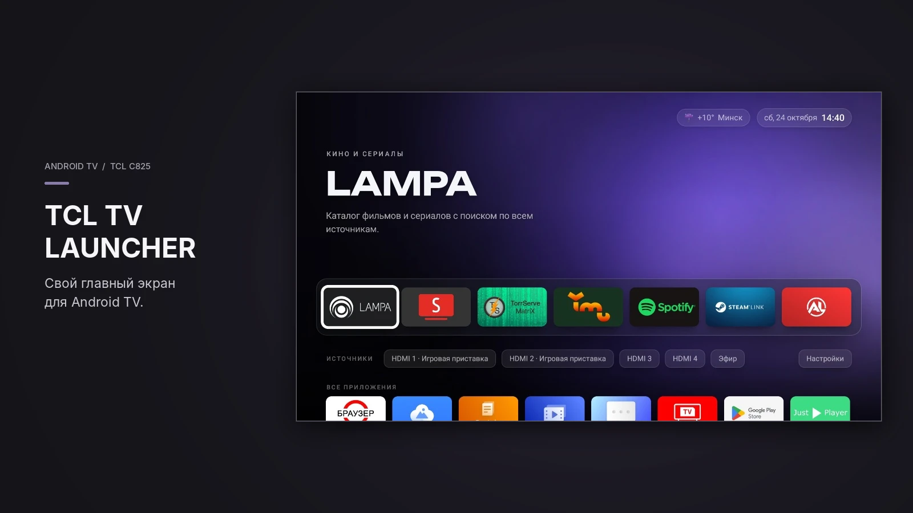
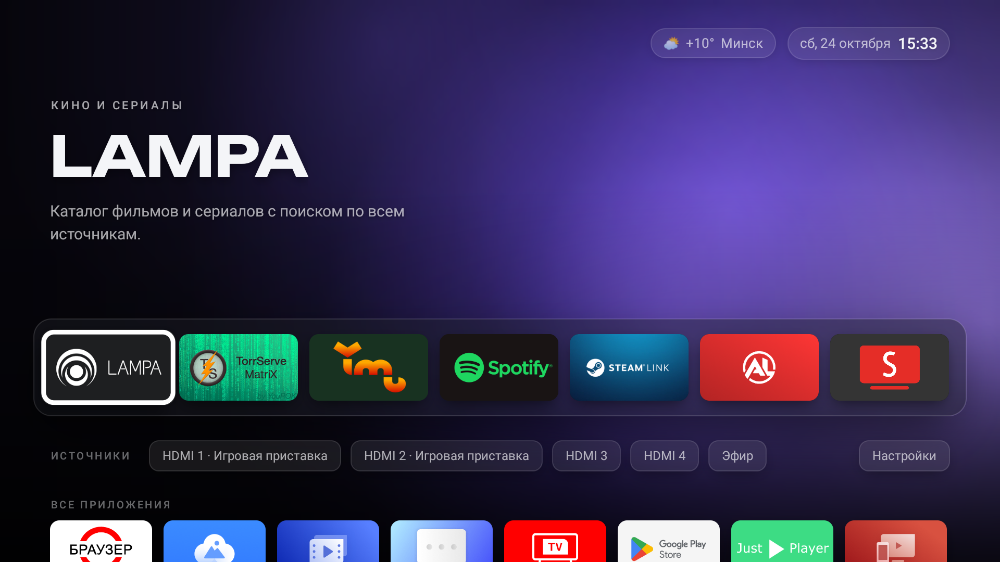
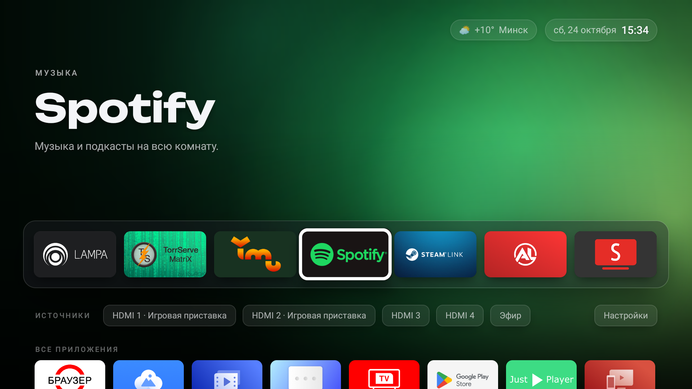
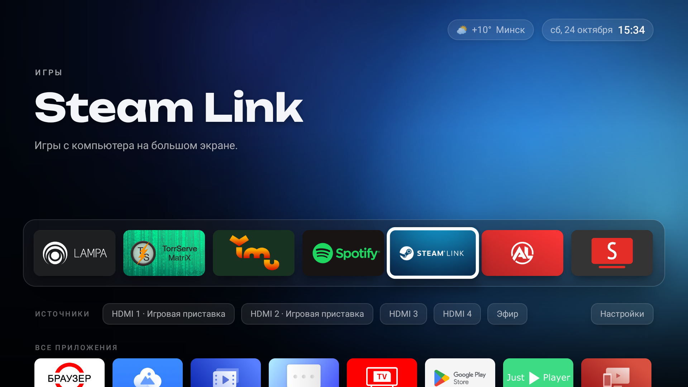
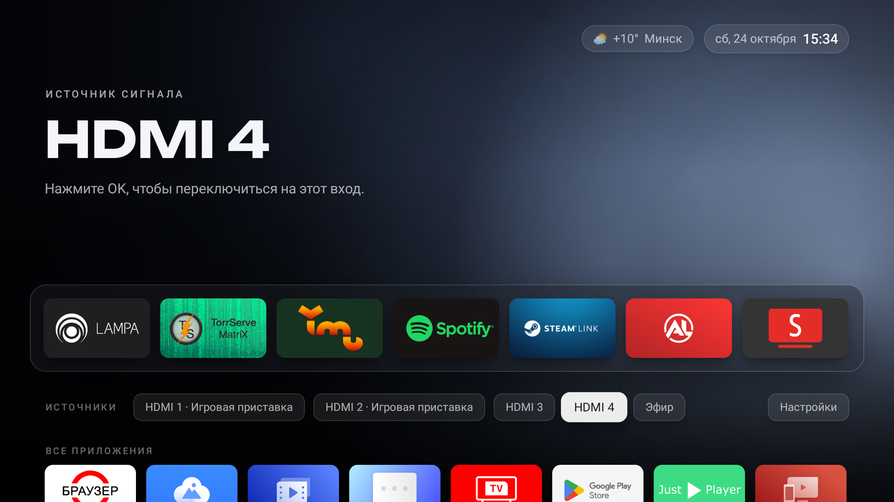
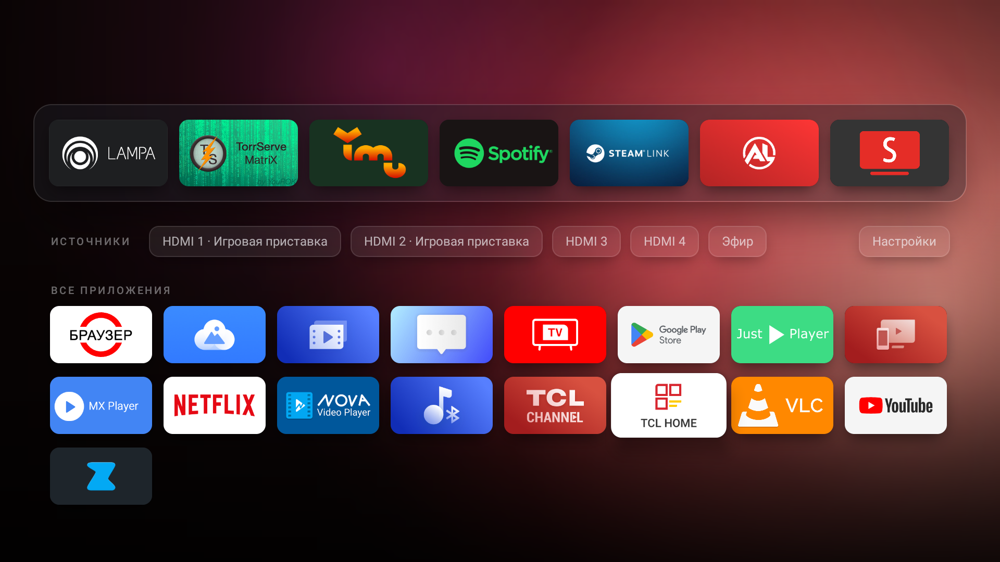
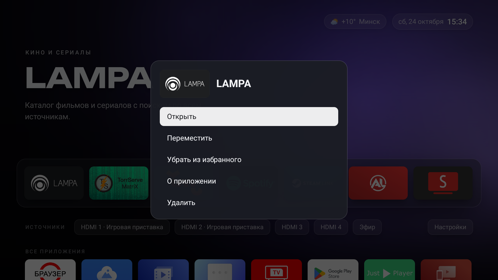
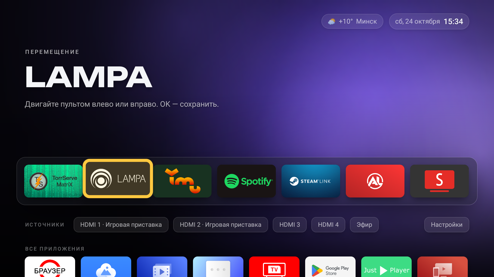

# TCL TV Launcher — быстрый лаунчер и чистка Android TV



Лёгкий лаунчер в стиле Apple TV и скрипт, который за пару минут чистит Android TV от рекламы и телеметрии. Всё ставится по сети с компьютера и откатывается одной командой. Сделан и проверен на TCL C825, работает на любом Android TV с Android 11 и новее.

> Неофициальный проект, не связан с TCL Corporation. Названия и логотипы приложений на скриншотах принадлежат их владельцам.



## Что внутри

- **Лаунчер «Кинотеатр».** Живой фон подстраивается под цвет выбранного приложения, на плитках родные баннеры приложений. Есть избранное, все приложения, HDMI-входы, часы и погода.
- **Быстрый.** APK меньше 0,5 МБ, без рекламы и рекомендаций, ровные 60 к/с. Когда пульт не трогают, фон замирает и процессор не нагружается.
- **Чистка.** Отключает рекламные ленты, телеметрию и ненужные службы (TCL, Google), ускоряет анимации, включает автоматическое время. Все изменения обратимы.
- **Безопасно.** Перед изменениями сохраняет состояние телевизора, `restore.sh` возвращает всё как было.

| | |
|---|---|
|  |  |
| Фон и шапка подстраиваются под приложение | Мягкие тени, шрифт Unbounded |
|  |  |
| HDMI-входы с твоими названиями, эфир, настройки | Все приложения: часы и шапка уходят, чтобы не мешать |
|  |  |
| Долгое OK — меню приложения | Порядок избранного меняется с пульта |

## Какие телевизоры подходят

Любой телевизор или приставка на **Android TV / Google TV с Android 11 и новее**: TCL, Sony, Philips, Xiaomi, Hisense, Haier, Kivi, Nvidia Shield, Chromecast with Google TV и другие.

Проверено на TCL C825 (Android TV 11). Лаунчер и настройки работают на любой марке. Список отключаемых пакетов (`tv-setup/packages.txt`) рассчитан на TCL и Google. На других марках скрипт просто пропустит пакеты, которых нет, а свои можно дописать в список.

## Установка

### 1. На телевизоре: включить отладку

1. Открыть «Об устройстве»:
   - **Android TV:** Настройки → Настройки устройства → Об устройстве
   - **Google TV:** Настройки → Система → Об устройстве
2. Нажать **7 раз** на «Сборка» («Сборка ОС Android TV»), пока не появится «Вы стали разработчиком».
3. Вернуться назад, открыть «Для разработчиков» и включить **«Отладка по USB»**.
   - На многих телевизорах (TCL, Xiaomi, Philips) этот же переключатель включает отладку по сети. Тогда переходи к шагу 4.
   - На Google TV и Android 12+ может понадобиться ещё **«Беспроводная отладка»**. Внутри будет «Подключить устройство с помощью кода»: там IP, порт и шестизначный код (см. шаг 3 ниже).
4. Узнать IP телевизора: Настройки → Сеть и Интернет → подключённая сеть.

### 2. На компьютере: поставить ADB

- **Windows** (запускать в Git Bash):
  ```bash
  winget install Google.PlatformTools
  ```
- **macOS:** `brew install android-platform-tools`
- **Linux:** `sudo apt install adb`

### 3. Только если телевизор просит код (беспроводная отладка)

```bash
adb pair 192.168.1.50:37123
```

Здесь IP, порт и шестизначный код — из окна «Подключить с помощью кода» на телевизоре. Порт для подключения в п. 4 будет другим: он написан на главном экране «Беспроводной отладки».

### 4. Запустить установку

```bash
sh tv-setup/setup.sh 192.168.1.50 "Санкт-Петербург"
```

- первый параметр — IP телевизора (если нужен порт: `192.168.1.50:41235`);
- второй — город для погоды, его можно не указывать.

Скрипт:
1. подключится и попросит подтвердить отладку на экране телевизора: поставь «Всегда разрешать» и нажми ОК;
2. сохранит текущее состояние в `tv-setup/backups/`;
3. отключит рекламу и телеметрию из `packages.txt` и пропустит то, чего на телевизоре нет;
4. поставит анимации 0.5 и автоматическое время;
5. установит лаунчер и найдёт город для погоды;
6. сделает «Кинотеатр» главным экраном. Если системный лаунчер стоит выше по приоритету, скрипт спросит, отключить ли его. Ответь `y`, иначе кнопка «Домой» будет открывать системный.

### 5. После установки

Выключи «Отладку по USB» (и «Беспроводную отладку») в «Для разработчиков». Пока они включены, телевизор принимает команды по сети.

## Откат

```bash
sh tv-setup/restore.sh
```

Скрипт берёт последнюю резервную копию, включает обратно всё отключённое, возвращает анимации и время и спрашивает, удалить ли лаунчер. Для конкретной копии: `sh tv-setup/restore.sh tv-setup/backups/<папка>`.

## Как пользоваться

| Кнопка | Что делает |
|---|---|
| OK | Открыть приложение, переключиться на HDMI |
| Долгое OK на плитке | Меню: открыть, переместить, добавить в избранное или убрать оттуда, о приложении, удалить |
| Вниз | Источники (HDMI, эфир, настройки), ниже — все приложения |
| Домой | Вернуться к первому приложению избранного |

В избранном до 7 приложений. Новые приложения появляются в «Все приложения» сами, с родными баннерами.

## Частые вопросы

**Скрипт пишет «unauthorized» или «нет ответа».** Посмотри на экран телевизора, там должен быть запрос. Если его нет, выключи и включи «Отладку по USB» и запусти скрипт ещё раз. Проверь, что компьютер и телевизор в одной сети.

**«Домой» открывает старый лаунчер.** При установке нужно было ответить `y` на вопрос об отключении системного лаунчера. Запусти `setup.sh` ещё раз.

**Пропал интернет при подключении по кабелю.** Посмотри IP в настройках сети. Если он не из твоей домашней сети (например, `10.x.x.x` вместо `192.168.x.x`), кабель воткнут в IPTV-порт роутера. Переставь его в другой LAN-порт.

**Прошивка включила обратно какие-то пакеты.** Некоторые службы TCL (`usercenter`, `notereminder`) прошивка включает при каждой загрузке. Они лёгкие и почти не мешают.

## Для разработчиков

| Папка | Что это |
|---|---|
| `tv-setup/` | `setup.sh`, `restore.sh`, `packages.txt` и готовый `kinoteatr.apk` |
| `kinoteatr-launcher/` | Исходники лаунчера (Java, без библиотек), `build.sh`, тесты `test.sh` |
| `docs/screenshots/` | Скриншоты с телевизора |

Сборка без Gradle: нужны JDK 17 и Android SDK (build-tools 34, platform android-34).

```bash
TV=192.168.1.50:5555 sh kinoteatr-launcher/build.sh install
```

Тесты прямо на телевизоре: около 60 проверок навигации, меню, избранного, положения экрана, памяти и плавности, ~12 минут. **Тесты сбрасывают избранное**, это стоит учитывать.

```bash
TV=192.168.1.50:5555 sh kinoteatr-launcher/test.sh
```

`debug.keystore` в репозиторий не попадает. Обновление ставится поверх старой версии только с тем же ключом подписи. Если собрать с новым ключом, лаунчер придётся удалить и поставить заново, а избранное сбросится.

Шрифт заголовков — [Unbounded](https://fonts.google.com/specimen/Unbounded), лицензия SIL Open Font License 1.1.

Лицензия проекта — [MIT](LICENSE).
